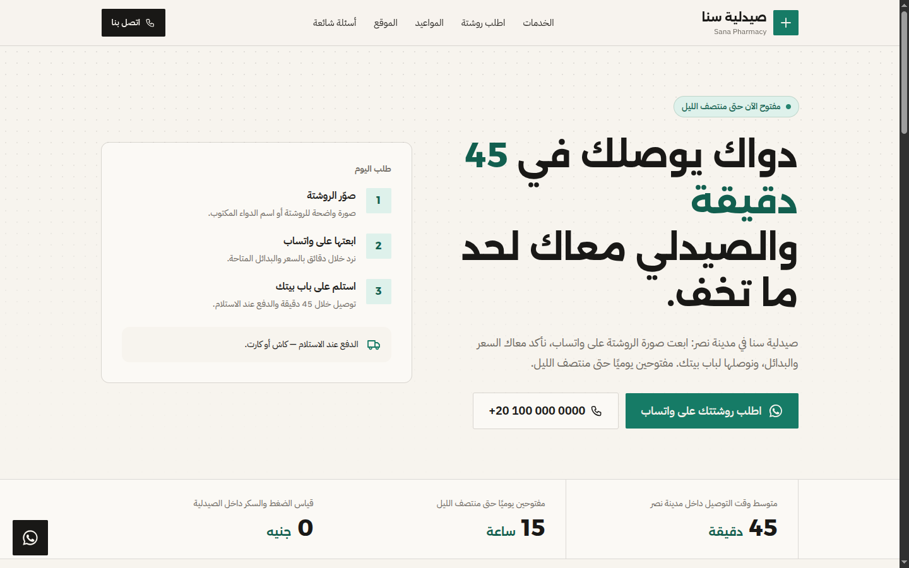
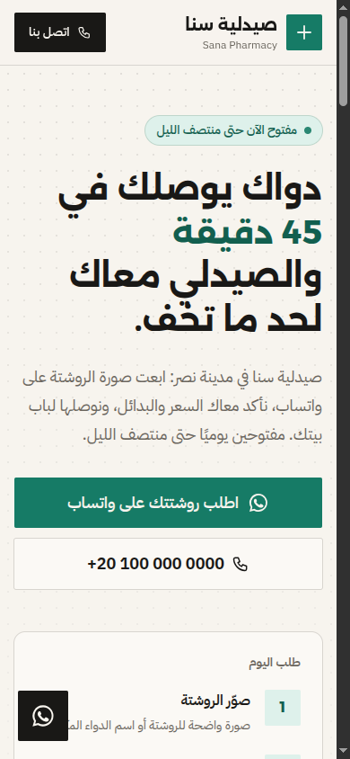

# Sana Pharmacy — Arabic landing page (concept)

A one-page, Arabic-first (RTL) website for a neighborhood pharmacy in Nasr City, Cairo.
It is a **concept project**: the pharmacy, phone number and address are fictional.



## What it does

- **WhatsApp ordering.** "Send your prescription" buttons open WhatsApp with a ready message.
- **Live open/closed badge.** It is computed in Cairo time, so a visitor abroad still sees the pharmacy's real status.
- **Opening hours** with today highlighted, and Friday hours handled separately.
- **Map and directions** (OpenStreetMap embed, Google Maps directions link). No API key is needed.
- **Contact form** with a consent checkbox and a honeypot against spam. Set `NEXT_PUBLIC_FORM_ENDPOINT`
  (Formspree, WebForms.to, Getform…) to receive messages by email. Without it, the form forwards the message to WhatsApp.
- **Local SEO:** `Pharmacy` + `FAQPage` JSON-LD with opening hours and geo, Open Graph image, `sitemap.xml` and `robots.txt`.
- **Accessible:** skip link, visible focus, semantic landmarks, `prefers-reduced-motion`.
- **One file to edit.** Every business detail (name, phone, hours, services, FAQ) lives in `src/lib/site.ts`.



## Stack

Next.js 16 (App Router, static export) · React 19 · TypeScript · Tailwind CSS 4 · Alexandria + IBM Plex Sans Arabic.
No runtime dependencies beyond React. It deploys to any static host (Vercel, Netlify, GitHub Pages, cPanel).

## Run it

```bash
pnpm install
pnpm dev      # http://localhost:3000
pnpm build    # static site in out/
```

---

## بالعربي

صفحة تعريفية لصيدلية في مدينة نصر (مشروع تجريبي — الاسم والأرقام وهمية).
العميل يبعت صورة الروشتة على واتساب بضغطة، يشوف الصيدلية مفتوحة دلوقتي ولا لأ بتوقيت القاهرة،
ويلاقي المواعيد والخريطة والأسئلة الشائعة ونموذج تواصل شغال. الصفحة سريعة على الموبايل،
ومجهزة لجوجل (بيانات النشاط المحلي ومواعيد العمل)، وكل بيانات الصيدلية في ملف واحد سهل التعديل.

---

Designed and built by **[Mahmoud Elnagdy](https://nagdista.com/)** — full-stack developer in Cairo, Egypt.
